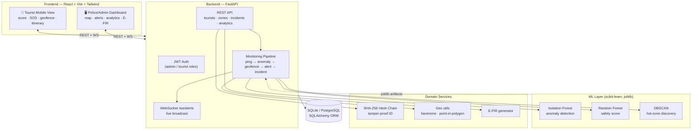
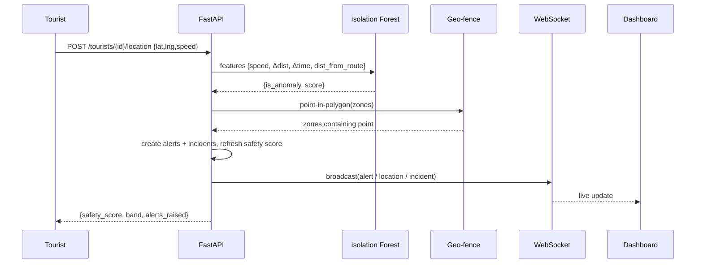
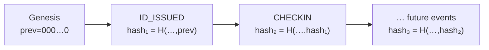

# 🛡️ Smart Tourist Safety Monitoring & Incident Response System

A full-stack AI/ML system that issues **tamper-proof digital tourist IDs**, monitors
tourist movement in real time, detects anomalies with machine learning, computes a
dynamic **safety score**, enforces **geo-fences**, handles **SOS/panic** events, and
drives a complete **incident-response workflow** — with a live police/admin dashboard
and a responsive tourist mobile view.

> B.Tech AI/ML major project. Backend: **FastAPI + SQLAlchemy + scikit-learn**.
> Frontend: **React (Vite) + Tailwind + Leaflet + Recharts**. Real-time via **WebSockets**.

---

## Table of Contents
1. [Feature Overview](#feature-overview)
2. [Architecture](#architecture)
3. [Tech Stack](#tech-stack)
4. [Security](#security)
5. [Deployment (Docker, one command)](#deployment)
   - [Android app on a home server (free)](#android-app-on-a-home-server-free)
6. [Project Structure](#project-structure)
7. [Local Setup & Run](#setup--run)
8. [Live Demo Mode](#live-demo-mode)
9. [The ML Models (features, training, evaluation)](#the-ml-models)
10. [Digital ID Hash-Chain](#digital-id-hash-chain)
11. [API Reference](#api-reference)
12. [Demo Accounts](#demo-accounts)

---

## Feature Overview

| # | Feature | How it works |
|---|---------|--------------|
| 1 | **Digital Tourist ID** | KYC registration → unique `STS-XXXX` ID + QR code. Records stored as a **SHA-256 linked hash chain** (blockchain-style, tamper-evident). ID validity tied to trip dates. |
| 2 | **AI Anomaly Detection** | **Isolation Forest** flags sudden location drop-off, prolonged inactivity, and abnormal speed (abduction pattern). **Route-deviation** via distance-to-itinerary. **DBSCAN** clusters historical incidents into auto high-risk zones. |
| 3 | **Safety Score (0–100)** | **Random Forest regressor** on zone risk, time-of-day, anomaly score, crime index, and weather (live OpenWeatherMap when `OPENWEATHER_API_KEY` is set, otherwise a deterministic fallback). Live, color-coded. |
| 4 | **Geo-fencing & Alerts** | Polygon zones + **point-in-polygon** (Shapely). Entering a high-risk/restricted zone auto-alerts tourist + dashboard over **WebSocket**. |
| 5 | **Panic / SOS** | One-tap SOS → nearest available police unit auto-dispatched, emergency contacts notified, **critical incident** created. |
| 6 | **Police/Admin Dashboard** | Live Leaflet map of all tourists + risk heat circles, real-time alert feed, tourist search by digital ID, **auto E-FIR** draft for missing persons, analytics charts. |
| 7 | **Tourist Mobile View** | Responsive page: safety score gauge, zone status, itinerary tracker, SOS, nearby police, opt-in live-tracking toggle. |
| 8 | **Incident Workflow** | Lifecycle `detected → acknowledged → dispatched → resolved`, ML/rule severity classification, response-time tracking. |
| 9 | **Self-Registration** | Public KYC form issues a digital ID and (optionally) a login, then auto-signs the tourist in. |
| 10 | **Security Audit Log** | Admin page + API trailing logins (with IP), SOS, and missing-person actions for accountability. |
| 11 | **Smart Trip Planner** | Turns the tourist's confirmed itinerary into a day-by-day plan, live against weather (services/weather.py), festivals/public holidays (services/festival.py), and permit flags (services/permit.py) for each day — a bad-weather day gets a real nearby indoor alternative (live OpenStreetMap lookup), not just a warning. |
| 12 | **Crowd & Queue Forecast** | Per-zone crowd forecast combining live tourist density, peak/off-peak season, real public holidays (Calendarific API), nearby festivals, and weather — plus a per-POI queue-wait estimate. Every forecast carries its `reasons[]`, never a bare number. |
| 13 | **Discovery** | Hidden spots, regional food, and homestays near the tourist — live from the OpenStreetMap Overpass API, merged with the database, with the DB as an automatic fallback if the live lookup is slow/unavailable. |
| 14 | **Multilingual Guide** | An everyday phrasebook (greetings, directions, food, shopping) in the tourist's chosen language — tap to translate and hear it spoken. |
| 15 | **Permit & E-Pass Automation** | Pre-fills a permit/e-pass application (Inner Line Permit, Restricted/Protected Area Permit, forest/wildlife entry) from the tourist's own KYC + itinerary. Two-step and honest: a draft the tourist reviews/edits, then an explicit confirm that **never submits anything to a government system** — it hands back the real official portal (Nagaland ILP, e-FRRO, Assam Sewa Setu) for the tourist to finish there themselves. |
| 16 | **Two-Way Live Voice Translator** | A conversation-mode translator for a tourist and a foreign traveler talking face-to-face — each side speaks in their own language, the other hears it translated aloud. |
| 17 | **Festival & Local Event Intelligence** | A calendar of this app's curated local festivals plus real national public holidays (Calendarific API), connected into the Smart Trip Planner and the Crowd & Queue Forecast rather than living as an isolated page. |
| 18 | **Simulation Core** | Admin → **Simulation**. Spawns up to 100 virtual tourists (`SIM-xxxx`) that walk real Guwahati routes, with **Play/Pause and 1x–60x speed**, a one-click **scripted scenario** (off-route → danger zone → inactivity → abduction jump → SOS) and per-tourist **event triggers**. Events only move the virtual tourist — the real ML anomaly model, geofencing, route-deviation and SOS/incident workflow decide what gets raised. Live map, tourist queue, alert stream and event log. |
| 19 | **AI/ML Evaluation Dashboard** | Admin → Analytics → **AI/ML Evaluation** tab. Generates labelled scenarios (safe vs suspicious) with the Simulation Core, runs the production detectors over them and reports **detection rate, false-alarm rate, precision/recall/F1, ROC & PR curves, confusion matrix, calibration (Brier/ECE), detection delay, response time, a Fairlearn fairness audit, SHAP attributions, drift and the model registry**. |
| 20 | **Push & SMS Alerts** | When a tourist triggers SOS, **Web Push** (VAPID; works with the PWA closed) goes to the tourist, their guardians, the assigned unit's responders and the control room, and **SMS** (Twilio) goes to emergency contacts and guardians. Also incident updates (acknowledged / dispatched / resolved), critical incidents and escalations. Admin **Alerts** page: delivery status, retries, history, tests. Click a notification → the incident. |
| 21 | **Fall & Crash Detection** | The phone's motion sensors (or a wearable, or a clearly-labelled simulation) spot a possible fall/crash → a full-screen **30 s "I AM SAFE – CANCEL ALERT" countdown** (or **Send SOS now**). Cancel and nothing is raised; let it run out and **one critical incident** (`fall_detected` / `crash_detected`) is opened through the existing monitoring pipeline — same Incidents page, alerts, push/SMS and escalation as any other emergency. The server owns the clock, so a closed app still escalates. |
| 22 | **Walk-Me-Home** | A tourist walking alone starts a **monitored journey** (destination, duration, check-in interval, chosen guardians). Guardians follow the timer and last location on their private link; **I AM SAFE – CHECK IN** resets the deadline. Miss one and a warning + grace period start; if the grace runs out the **existing check-in engine opens a critical incident** for the police/admin dashboard. Deadlines are server-owned, so a closed app still escalates. |
| 23 | **Intelligent Response Management** | Every incident — SOS, fall/crash, Walk-Me-Home, anomaly, missing person, field report — is **classified CRITICAL / HIGH / MEDIUM / LOW by transparent rules** (with a stored explanation), given a **backend response deadline** from its severity, and **auto-escalated** primary responder → supervisor → higher authority if nobody acknowledges it, up to one fixed **global timeout** (the incident stays open). Admin **Response & SLO** page: live countdowns, severity override with a mandatory reason, SLO compliance from real timestamps, charts and settings. |
| 24 | **Emergency Medical Profile (QR)** | Tourists optionally record blood group, allergies, conditions, medications and emergency contacts. The existing Digital ID QR (token only, **no medical data**) lets an **authorized responder** open that profile after the backend checks the token and role; every access is **rate-limited and audited**, and the tourist can edit, regenerate or revoke the QR. Data is encrypted at rest and labelled tourist-reported. |

All seven live in the tourist app's new **Explore** tab (🌍). None of them touch any existing feature's data or routes — they're additive, reusing the existing itinerary, zone, weather, translation, and POI infrastructure wherever possible. Two external, free-tier data sources back them: OpenStreetMap's **Overpass API** (Discovery + indoor alternatives — no key needed) and **Calendarific** (public holidays — free key needed, see `backend/.env.example` / `CALENDARIFIC_API_KEY`). With no Calendarific key, holiday-driven signals are simply absent, never fabricated.

---
| 25 | **Privacy, Consent & Data Rights (DPDP-oriented)** | Purpose-specific consent (nothing pre-ticked) with real withdrawal effects, a configurable retention engine with a deletion-job audit, location-history viewing/deletion, password-gated **Download My Data** (JSON/CSV, encrypted, expiring), full **Delete My Account** with honest status, a privacy dashboard and grievance desk. Not a compliance certificate - see `docs/DPDP_PRIVACY.md`. |

## Architecture



### Monitoring pipeline (per GPS ping)



---

## Tech Stack

- **Backend:** Python 3.11, FastAPI, SQLAlchemy 2, Pydantic v2, JWT (python-jose), bcrypt
- **ML:** scikit-learn (IsolationForest, DBSCAN, RandomForestRegressor), pandas, numpy, joblib
- **Geo:** Shapely (point-in-polygon), haversine
- **DB:** SQLite (dev) — swap `DATABASE_URL` for PostgreSQL
- **Frontend:** React 18, Vite, Tailwind CSS, React-Leaflet, Recharts, Axios
- **Real-time:** native WebSockets
- **Deploy:** Docker + docker-compose (PostgreSQL + backend + nginx-served SPA)

---

## Security

The system is built to be deployed safely — **nothing security-sensitive is
hardcoded** and common web-attack classes are addressed:

| Area | Protection |
|------|------------|
| **Secrets** | `SECRET_KEY` is env-only; the app **refuses to start in production** without a strong key. Dev auto-generates an ephemeral key. |
| **Authentication** | JWT (HS256) with `iat`/`nbf`/`exp`/`jti` claims and a token `type` guard; bcrypt (cost 12) password hashing. |
| **Authorization** | Role-based (`admin` / `tourist`). Tourists can only read/act on **their own** record (`require_self_or_admin`); admin-only routes for dashboards, incidents, audit, E-FIR. |
| **Brute-force** | Per-IP **rate limiting** — strict on `/auth/login` (429 after N attempts), coarse global limit on every API route. |
| **WebSocket** | The live feed carries tourist PII, so the socket **requires a valid admin token** (rejected otherwise). |
| **Input validation** | Pydantic bounds on every input: lat∈[-90,90], lng∈[-180,180], speed caps, string length limits, polygon vertex validation, enum-checked fields, trip-date sanity. |
| **Injection** | SQLAlchemy ORM (parameterised) throughout — no string-built SQL. |
| **Transport headers** | `X-Frame-Options: DENY`, `X-Content-Type-Options: nosniff`, `Referrer-Policy`, `Permissions-Policy`, a restrictive **CSP**, and **HSTS** in production. |
| **Host / CORS** | `TrustedHostMiddleware` (explicit `ALLOWED_HOSTS`) + locked-down CORS origins/methods/headers. |
| **DoS surface** | Request **body-size limit** (413 on oversized payloads). |
| **Auditability** | A **security audit log** records logins (success/failure + IP), SOS, and missing-person actions, viewable in the admin **Audit Log** page. |
| **Least privilege** | Backend Docker image runs as a **non-root** user; interactive API docs are disabled in production. |
| **Privacy** | Documents stored masked/mock; live location tracking is **opt-in** by the tourist. |

> Single-instance note: the rate limiter and WebSocket manager are in-process. For
> a horizontally-scaled deployment, back them with **Redis** (pub/sub + shared
> counters) and run multiple workers; the code is structured to swap these in.

---

## Deployment

**One command** brings up PostgreSQL, the API, and the nginx-served SPA:

```bash
cp .env.example .env
# generate and paste a strong key:
python -c "import secrets; print(secrets.token_urlsafe(48))"   # -> SECRET_KEY in .env
docker compose up --build
```

Then open **http://localhost:8080**. The backend trains its ML models at image
build time (and again on first start if the artifacts are missing). Demo data is **not**
seeded by default; to seed a demo deployment set `SEED_ON_START=true` **and**
`SEED_FORCE=true` in `.env` — passwords are random and printed once in the backend logs
unless you set strong `SEED_*_PASSWORD` values. In production the backend refuses to start
if any of them is a known weak password (e.g. `admin123`).

What compose runs:
- **db** — PostgreSQL 16 with a persistent volume + healthcheck
- **backend** — FastAPI (non-root, single worker) reading all config from env
- **frontend** — React build served by nginx, proxying `/api` and `/ws` to the backend

For a real deployment set `ENVIRONMENT=production`, an explicit `ALLOWED_HOSTS`,
your real `CORS_ORIGINS`, leave `SEED_ON_START=false`, and put a TLS-terminating reverse
proxy in front. Every tunable lives in `.env` / `backend/.env.example` — no code edits.

### Hosting the backend (Render / Railway / a VM — not Vercel)

The backend must run on a **long-running** host. Vercel serverless can't hold the
`/ws/alerts` WebSocket and can't run the APScheduler jobs (SOS escalation, missed check-ins,
retention deletion, disaster feed). So:

- **Backend → Render** (`render.yaml` at the repo root: Docker service + Postgres). Set
  `CORS_ORIGINS` to your Vercel URL and `ALLOWED_HOSTS` to the Render hostname. Use an
  always-on plan; free tiers sleep and silently stop the scheduler and sockets.
- **Frontend → Vercel** (`vercel.json`): edit the `/api` rewrite destination to your Render URL
  and set `VITE_WS_ORIGIN=wss://<your-service>.onrender.com` at build time so the browser opens
  the WebSocket directly to the backend.

### Android app on a home server (free)

The tourist side ships as an Android app (Capacitor, `frontend/android/`) talking to the
backend running on a PC at home. Everything used is free: Docker Desktop (personal use),
Tailscale (personal plan), Firebase Cloud Messaging, Android Studio, and the APK is installed
directly instead of through the Play Store. The app is tourist-only; admin and responder
consoles stay on the web. iPhone is not supported (it needs a Mac to build).

What the app adds over the website: login that survives restarts (refresh token in app storage,
`src/lib/nativeSession.js`), location that keeps flowing with the screen locked (foreground
service, `src/hooks/useGeolocation.js`), push through FCM (`src/lib/pushService.js`,
`POST /api/notifications/push/subscribe-fcm`), and the phone's own speech recognition and
text-to-speech.

**1. Home server (once)**
1. Install Docker Desktop and turn on "Start Docker Desktop when you sign in". Set Windows to
   never sleep while plugged in, and to sign in automatically so Docker starts after a reboot.
2. Install [Tailscale](https://tailscale.com/download) and sign in. In the admin console turn on
   HTTPS certificates and Funnel, and **disable key expiry** for this PC (otherwise the address
   stops working after ~180 days). Then run `tailscale funnel --bg 8080`. Your address is
   `https://<pc-name>.<tailnet>.ts.net`; it stays the same when the PC changes Wi-Fi, router or
   IP. Don't rename the PC in Tailscale or switch accounts: the address would change and the app
   would need a rebuild.
3. `cp .env.example .env` and fill in `SECRET_KEY`, `POSTGRES_PASSWORD` and the "Home server"
   block (your address in `PUBLIC_BASE_URL`, `CORS_ORIGINS`, `ALLOWED_HOSTS`;
   `REFRESH_COOKIE_SECURE=true`; `FCM_CREDENTIALS_FILE=/app/secrets/firebase.json`).
4. `docker compose up -d --build`. All services restart on their own after a reboot.
   For an admin login on the web dashboard, start once with `SEED_ON_START=true SEED_FORCE=true`
   and strong `SEED_*_PASSWORD`s, then set both back to `false` (seeding wipes data).
5. Open your address in the phone's browser and log in to check it works.
6. Optional daily backup (Task Scheduler):
   `docker compose exec -T db pg_dump -U tourist tourist_safety > backups\musafir.sql`

**2. Firebase (push notifications, once)**
1. In the [Firebase console](https://console.firebase.google.com) create a project (Spark,
   free) and add an Android app with package name `com.musafir.app`.
2. Download `google-services.json` into `frontend/android/app/`.
3. Project settings → Service accounts → Generate new private key; save it as
   `secrets/firebase.json` in the repo root, then `docker compose up -d` again.
Both files are gitignored.

**3. Build and install the APK**
1. Install [Android Studio](https://developer.android.com/studio) (includes Java and the SDK).
2. `cp frontend/.env.android.example frontend/.env.android` and put your address in it.
3. Create the signing key once, from `frontend/android/`:
   `keytool -genkey -v -keystore musafir.jks -keyalg RSA -keysize 2048 -validity 10000 -alias musafir`,
   then copy `keystore.properties.example` to `keystore.properties` and fill in the passwords.
   Back up `musafir.jks` and the passwords: updates only install over the app if signed with the same key.
4. `cd frontend && npm run build:android`, then `cd android && gradlew assembleRelease`
   (or `npm run android:open` and build from Android Studio).
5. Copy `android/app/build/outputs/apk/release/app-release.apk` to the phone and open it
   (allow "Install unknown apps"), or `adb install -r app-release.apk` over USB.
6. On the phone: allow location ("While using the app" is enough: the foreground service keeps
   it in use), notifications, camera and microphone when asked, and set the app's battery usage
   to "Unrestricted" so Android doesn't stop location in the background.

To update the app, pull the code, repeat step 4 and install the new APK over the old one.

**Password reset emails (free, Gmail).** "Forgot password" emails a one-time code (valid 30
minutes). Turn on 2-Step Verification for the Gmail account, create an App Password at
https://myaccount.google.com/apppasswords, then add to `.env`:
`SMTP_USERNAME=your.address@gmail.com` and `SMTP_PASSWORD=<the 16-letter app password>`, and run
`docker compose up -d backend`. Without these, codes are not emailed; in production they are not
written to the logs either, so an admin resets a forgotten password by hand.

**Limits.** If the PC or home internet is down the app can't reach the server; an SOS sent
meanwhile is queued on the phone and sent when it's back, but location pings from that time are
not. SMS needs a Twilio account. Disaster alerts reach the app over its live connection, not push.

### Deploying for the phone app (free demo on Render)

`render.yaml` is set up for a free demo: **free web service + free Postgres**. The web service sleeps after
~15 min idle (the first request afterwards takes up to a minute, and background jobs/WebSockets pause while it
sleeps); the free database expires after ~30 days. Switch both `plan:` lines to paid plans for an always-on setup.

1. Merge your code to `main` on GitHub (Render builds from GitHub).
2. Render → **New → Blueprint** → pick the repo and `main`. It reads `render.yaml`.
3. Fill the prompts: `PUBLIC_BASE_URL` (the service's `https://…onrender.com` address), `VAPID_PUBLIC_KEY` /
   `VAPID_PRIVATE_KEY` (`python -m app.scripts.generate_vapid_keys`), and three strong `SEED_*_PASSWORD`s.
   Leave `TWILIO_*` and `APNS_*` empty (SMS stays in demo mode; native iOS push needs an Apple key).
4. After the **first** successful start set `SEED_ON_START` to `false` in the Environment tab: the seed script
   **deletes all data** each time it runs.
5. Check `https://<address>/api/health`, then rebuild the phone app against it: put
   `VITE_API_BASE=https://<address>/api` and `VITE_WS_ORIGIN=wss://<address>` in `frontend/.env.production.local`,
   then `npm run build && npx cap sync ios` and Run in Xcode (see `docs/IOS_APP.md`).
6. Once live, tighten `ALLOWED_HOSTS` from `*` to the service's hostname.

---

## Project Structure

```
major project/
├── backend/
│   ├── app/
│   │   ├── main.py              # FastAPI app + router wiring
│   │   ├── core/               # config, security (JWT, bcrypt)
│   │   ├── db/                 # SQLAlchemy engine/session
│   │   ├── models/            # ORM: tourist, zone, incident, alert, police, user
│   │   ├── schemas/           # Pydantic request/response models
│   │   ├── api/               # routers: auth, tourists, zones, incidents, analytics, ws
│   │   ├── services/          # hashchain, geo, ml_service, safety, monitoring, efir
│   │   ├── websocket/         # connection manager
│   │   ├── ml/                # ⭐ data generation + model training scripts
│   │   └── scripts/           # seed.py, simulate.py (live demo)
│   ├── ml_models/             # saved *.joblib + metrics.json + hotzones.json
│   └── requirements.txt
├── frontend/
│   └── src/
│       ├── pages/admin/       # Dashboard, TouristSearch, Incidents, Analytics
│       ├── pages/tourist/     # TouristApp (mobile view)
│       └── components/        # ui, mapIcons, geo
└── README.md
```

---

## Setup & Run

> Prerequisites: **Python 3.11** and **Node 18+**. (Python 3.11 is recommended — the
> ML wheels install cleanly there.)

### 1. Backend

```bash
cd backend
py -3.11 -m venv venv            # Windows;  python3.11 -m venv venv on macOS/Linux
venv\Scripts\activate            # source venv/bin/activate on macOS/Linux
pip install -r requirements.txt

# Train ML models (writes ml_models/*.joblib + metrics.json)
python -m app.ml.train_all --crime-index-source ncrb   # real NCRB-calibrated crime index; also writes docs/ML_EVALUATION.md

# Create the database schema (required before seeding)
alembic upgrade head

# Seed demo data (tourists, zones, police units, incidents).
# Without the SEED_*_PASSWORD variables, random passwords are generated and
# printed -- and re-running the seed regenerates them. Pin them for a stable demo:
SEED_ADMIN_PASSWORD=admin123 SEED_TOURIST_PASSWORD=tourist123 \
SEED_RESPONDER_PASSWORD=responder123 python -m app.scripts.seed

# Run the API on port 8001 -- the port the Vite dev proxy targets
# (docs at http://127.0.0.1:8001/docs)
python -m uvicorn app.main:app --port 8001 --reload
```

### 2. Frontend

```bash
cd frontend
npm install
npm run dev                      # http://localhost:5173
```

Open **http://localhost:5173** and log in with a [demo account](#demo-accounts).
Vite proxies `/api` and `/ws` to the backend on **port 8001** (see `frontend/vite.config.js`),
so start the API on that port or logins will fail.

---

## Simulation Core

Demo MUSAFIR without real tourists: **Admin → Simulation** (`/admin/simulation`).

1. **Spawn** N tourists (default 50) — ordinary tourist rows with ids `SIM-0001…`, each on a looping route between real Guwahati landmarks that stays clear of the high-risk zones.
2. **Play** and pick a speed (1x, 2x, 5x, 10x, 30x, 60x). Simulated time = speed × real time; pings are stamped with *simulated* time so inactivity, speed and trajectory maths stay correct at any speed.
3. Trigger events on a selected tourist (or a random one): **enter danger zone**, **go off-route**, **go inactive** (needs ~70 simulated minutes of silence — use 30x–60x), **abduction jump**, **SOS**, or **mark safe**. **Run full demo scenario** chains five of them over ~13 simulated minutes.
4. Watch detections arrive on the map, the **Alerts** tab and the **Incidents** page, and walk the normal acknowledge → dispatch → resolve workflow.

Nothing is faked: the simulator only supplies GPS. `POST /api/simulation/*` (admin-only; see `/docs`) drives `process_ping` and `trigger_sos` — the same code real pings hit. **Purge data** deletes every simulated tourist and their alerts/incidents/pings.

Notes: the clock is in-process, so run the backend with a single worker (`WEB_CONCURRENCY=1`, already the default here). Set `SIMULATION_ENABLED=false` to disable the endpoints in a real deployment. The older CLI scripts (`app/scripts/simulate.py`, `simulate_band.py`) still work for headless runs.

---

## AI/ML Evaluation Dashboard

**Admin → Analytics → AI/ML Evaluation.** Press **Run evaluation** (50–500 scenarios, optional seed).

1. **Generate** — the Simulation Core's own physics builds labelled scenarios: *safe* (normal walk, taxi ride, short signal gap, walk near a risky zone) and *suspicious* (enters high-risk zone, strays off route, goes silent, abduction jump). The label is fixed by construction. SOS is excluded — it is a human trigger, not a model output.
2. **Run** — the same primitives `process_ping` uses score every ping: the Isolation Forest, the route-deviation rule, the geofence check, plus the safety Random Forest. A test (`test_evaluation_verdicts_match_the_real_pipeline`) asserts the harness's per-ping verdicts equal the alerts the real pipeline raises.
3. **Measure** — detection rate (recall), false-alarm rate, precision, F1, ROC-AUC, ROC/PR curves, confusion matrix, per-detector and per-scenario breakdowns, **calibration curves** (Brier score, expected calibration error), **detection delay** (simulated minutes) and **inference latency** (real ms), **response time** (from real incident timestamps), a **fairness audit** by traveller type and age band (Fairlearn equalized-odds / parity gaps; groups are synthetic attributes, no real personal data), **SHAP** feature attributions, data drift, and the **model registry** (versions, training date, data hash, hold-out metrics).

Honesty built in: results measure detection of *scripted simulated behaviour*, not real-world accuracy; precision depends on scenario prevalence, so the expected precision at a realistic 5% prevalence is shown too. The harness deliberately includes hard negatives, and they expose real weaknesses (e.g. the Isolation Forest flags many 20–40 minute signal gaps). Runs are stored in `EVALUATION_DIR` (default `evaluation_reports/`, last 12 kept) and are read-only with respect to tourist, alert and incident data.

API (admin-only): `POST /api/ml/evaluation/run`, `GET /api/ml/evaluation/latest`, `GET /api/ml/evaluation/runs/{id}`.

---

## Push & SMS Alerts

Emergency notifications that reach people **without MUSAFIR being open**.

| Event | Push (Web Push) | SMS (Twilio) |
|---|---|---|
| **SOS triggered** | tourist (not for a silent/duress SOS), guardians who opted in, the assigned unit's responders, control room | emergency contacts, guardians' phone numbers |
| Incident acknowledged / dispatched / resolved | tourist + guardians (SOS only); responders on dispatch | family on *resolved* |
| Critical non-SOS incident | control room | — |
| Escalation (nobody acknowledged) | control room + assigned responders | emergency contacts |

**Set up**
1. *Push:* works out of the box in development (a VAPID key pair is generated into `backend/.vapid_keys.json`). For production run `python -m app.scripts.generate_vapid_keys` and set `VAPID_PUBLIC_KEY` / `VAPID_PRIVATE_KEY` (push stays off in production without them). Set `PUBLIC_BASE_URL` to the frontend origin.
2. *SMS:* create a Twilio account, then set `NOTIFICATION_CHANNEL=twilio`, `TWILIO_ACCOUNT_SID`, `TWILIO_AUTH_TOKEN` and `TWILIO_FROM_NUMBER` (or `TWILIO_MESSAGING_SERVICE_SID`). Until then SMS runs in **demo mode**: rows are recorded as *Simulated* and nothing is texted. Use `SMS_ALLOWLIST` while testing. Twilio trial accounts can only text numbers verified in your Twilio console.
3. *Subscribe a device:* tourists — **Me → Emergency alerts**; guardians — the button on their share page (no account needed); responders — the Responder Console; admins — **Alerts** page. The browser will ask for permission.

**Service worker.** `frontend/public/push-sw.js` is loaded into the PWA's service worker (`importScripts`), shows the notification (an SOS stays on screen until acted on), and on click opens/focuses the target page (same-origin only). Service workers don't run under plain `vite dev`: test with `npm run build && npm run preview` (port 4173, proxies to the API), or `VITE_DEV_SW=true npm run dev`. Browsers need HTTPS (or localhost) for push; iOS requires the app to be added to the Home Screen.

**Delivery guarantees.** Rows are written inside the SOS transaction and delivered *after* it commits, on worker threads — the SOS response never waits on Twilio or a push service, and an SOS that rolls back notifies nobody. Each (event, incident, channel, recipient) is sent once (duplicates are logged as *Not sent*). Transient failures (network, 429/5xx) retry with backoff (30 s, 2 min, 8 min; 3 attempts) via a scheduler tick; permanent ones (expired subscription → deactivated, invalid number) don't. Everything is visible in **Admin → Alerts** with a Retry button.

**Safety rules.** The console fallback is labelled *Simulated*, never *Sent*. SMS is never sent for simulated (`SIM-`) tourists. A silent SOS never pushes to the tourist's own screen and tells every recipient not to call. Phone numbers are stored encrypted and shown masked.

**Not built:** Firebase Cloud Messaging (Web Push with VAPID is the standard that FCM itself carries for Chrome, so no Firebase account is needed), native mobile push, and OTP verification of contact phone numbers.

API: `GET /api/notifications/push/public-key`, `POST …/push/subscribe`, `…/push/guardian-subscribe`, and (admin) `GET …/logs`, `GET …/summary`, `POST …/logs/{id}/retry`, `POST …/test`.

---

## Fall & Crash Detection

Automatic "Are you OK?" for treks, two-wheelers and solo travel. Detects a possible fall or crash, gives the tourist **30 seconds to say they are safe**, and — only if they don't — raises a **critical incident through the existing pipeline** (`monitoring._create_alert` + `_open_incident`, the same helpers behind the wearable fall flag and SOS). There is no separate alert system.

```
phone motion sensor ─► on-device detector ─┐
wearable (device key) ─────────────────────┼─► fall_event (pending, server-side deadline)
simulation (labelled) ─────────────────────┘          │
        ┌───────────── I AM SAFE ─────────────────────┤ → cancelled     (no incident, ever)
        ├───────────── SEND SOS NOW ──────────────────┤ → sos_triggered (existing SOS workflow)
        └───────────── 30 s pass ─────────────────────┘ → confirmed      (1 critical incident)
```

**How it behaves**
- **Detection (on the phone).** `frontend/src/lib/fallDetector.js` reads the accelerometer + gyroscope: *fall* = free-fall → impact → stillness; *crash* = hard impact while GPS speed was recently high → stillness. Walking, jogging, bumps, and a dropped-then-picked-up phone are ignored (no stillness afterwards). **All thresholds come from the server** (`FALL_*` below) — the browser has nothing hardcoded. A crash needs a real GPS speed reading; without one a hard impact is classed as a fall, never a crash.
- **Privacy.** Monitoring is opt-in (**Help → Fall & crash detection → Turn on motion monitoring**), a "Fall detection on" pill shows on every screen while it runs, raw sensor readings never leave the phone, and only a small summary (peak g, free-fall/stillness ms, speed) is sent when something is detected. Unknown fields are rejected by the API.
- **Countdown.** The deadline is fixed **server-side** when the event starts. The app shows it (anchored on the server's `seconds_remaining`, so re-renders, background tabs and a wrong phone clock cannot change it) and calls `confirm` at zero. If the app is closed, the phone dies or the network drops, a backend sweep (`FALL_SWEEP_TICK_SECONDS`) still raises the incident after the deadline plus a short grace.
- **No race, no duplicates.** The only way out of `pending` is one conditional `UPDATE … WHERE status='pending'`: "I AM SAFE" and expiry can't both win, and the incident is created in the same transaction as the winning update. A retried request (same `client_event_id`) returns the same event; a second detection while one is pending, or right after an incident, is folded into it; a database index allows one pending event per tourist.
- **Missing GPS.** The event's fix → the tourist's last known location → an incident without a location (flagged "Location unavailable"). It never errors.
- **Notifications.** The control room is pushed and the incident broadcast on the live WebSocket feed, exactly like other critical incidents; guardians and emergency contacts also get push/SMS ("may have had a fall…"); the existing escalation clock starts. See [Push & SMS Alerts](#push--sms-alerts) for provider setup.
- **Wearables.** A band authenticated with its device key calls `POST /api/devices/{device_id}/fall-event` and enters the **same** countdown (the tourist's phone shows it over the live channel and can cancel; the band can cancel with `…/fall-event/{id}/cancel`). Nothing is shown unless a band actually sends an event. *(The older `fall_detected` flag in `/devices/{id}/telemetry` is unchanged and still opens an incident immediately.)*
- **Not a guarantee.** It cannot detect every fall or crash and can fire by mistake (e.g. a phone tossed on a bed) — which is why a detection only ever starts a cancellable countdown. The UI says so.

**Configuration** (all env vars, see `backend/app/core/config.py`)

| Variable | Default | Meaning |
|---|---|---|
| `FALL_DETECTION_ENABLED` | `true` | Master switch (endpoints 404, app hides the card) |
| `FALL_COUNTDOWN_SECONDS` | `30` | The cancellation window |
| `FALL_CONFIRM_GRACE_SECONDS` | `5` | Extra time before the sweep raises the incident (lets an in-flight cancel win) |
| `FALL_SWEEP_TICK_SECONDS` | `5` | How often expired countdowns are swept |
| `FALL_DEDUPE_WINDOW_SECONDS` | `120` | Detections within this window of a pending/raised event are folded into it |
| `FALL_MAX_EVENT_AGE_SECONDS` | `120` | Cap on how stale a delayed (offline-retried) detection may be |
| `FALL_SIMULATION_ENABLED` | `true` | Demo mode (**set `false` in production**) |
| `FALL_FREEFALL_G`, `FALL_FREEFALL_MIN_MS`, `FALL_IMPACT_G`, `FALL_FREEFALL_IMPACT_WINDOW_MS`, `FALL_CRASH_IMPACT_G`, `FALL_CRASH_MIN_SPEED_KMH`, `FALL_STILLNESS_DEV_G`, `FALL_STILLNESS_GYRO_DPS`, `FALL_STILLNESS_MS`, `FALL_POST_IMPACT_OBSERVE_MS`, `FALL_DETECTOR_COOLDOWN_SECONDS` | see config | Detector thresholds, served to the client |

Frontend (optional, `frontend/.env`): `VITE_FALL_SPEED_WINDOW_MS`, `VITE_FALL_SENSOR_PROBE_MS`, `VITE_FALL_SPEED_MAX_AGE_MS`, `VITE_FALL_RETRY_MS`.

**Set up.** Run `alembic upgrade head` (adds the `fall_events` table). No new dependencies. Real sensor detection needs a **phone** and **HTTPS** (browsers hide motion data on plain HTTP; `localhost` counts as secure); iOS Safari shows a motion-permission prompt when you tap *Turn on motion monitoring*.

### How to test it

**A. Simulation mode (any laptop — no sensor needed)**
1. Start the API and frontend as in [Setup & Run](#setup--run); sign in as a tourist (e.g. `aarav@example.com`). In another window sign in as admin and open **Incidents**.
2. Tourist app → **Help** tab → **Fall & crash detection** → under **Simulation mode** tap **Simulate a fall**.
3. A red full-screen alert appears, badged **SIMULATION — not a real sensor detection**, counting down from 30.
   - **Cancel path:** tap **I AM SAFE – CANCEL ALERT** → "Alert cancelled". Admin Incidents shows nothing new; the card's history shows *Cancelled — you were safe*.
   - **Expiry path:** do nothing for 30 s → "Emergency raised · Incident #N". On the admin **Incidents** page a **critical `fall_detected`** incident appears live (tagged `[SIMULATED]`), with a timeline entry "Raised from fall_event…". Try **Simulate a crash** for `crash_detected`.
   - **Immediate SOS:** tap **SEND SOS NOW** → a normal SOS incident, nearest unit dispatched, Emergency Mode screen opens.
   - **Closed-app guarantee:** start a simulated fall, then close the tab within the 30 s. After the deadline (+ grace) the incident appears anyway.
4. Simulated events notify the control room only — never real contacts or guardians by SMS.

**B. Real phone sensors**
1. Serve the frontend over HTTPS (a deploy, or an HTTPS tunnel to `npm run dev`) and open it on a phone; sign in; set `VITE_SIMULATE_GPS=false` so GPS speed is real.
2. **Help → Fall & crash detection → Turn on motion monitoring** (allow motion access). The status reads **Monitoring active** and the green pill appears. If it says *Sensor not sending data* or *No motion sensor*, the device isn't providing readings and nothing is being monitored.
3. Test over a soft surface (a bed or cushion, ~30 cm): drop the phone and let it lie still ~2 s → the countdown starts. Walking or shaking it must **not** trigger anything (tune with the `FALL_*` variables if needed). **Don't drop your phone onto a hard floor, and never test while driving.**

**C. Wearable (curl)**
```bash
# register a band as admin (returns its one-time key), then:
curl -X POST http://127.0.0.1:8001/api/devices/BAND-1/fall-event \
  -H "X-Device-Key: <key>" -H "Content-Type: application/json" \
  -d '{"event_type":"fall","lat":26.14,"lng":91.73}'
```
The tourist's phone shows the countdown immediately; cancel it there, or `POST …/fall-event/{id}/cancel`, or leave it to raise the incident.

**D. Automated tests**
```bash
cd backend  && python -m pytest tests/test_fall_detection.py
cd frontend && npx vitest run src/lib/fallDetector.test.js src/components/FallDetection.test.jsx
```

**Limitations.** Detection runs only while the page is open and the screen is on (browsers suspend sensors in the background; wrapping the PWA with Capacitor is the fix). The server sweep protects an *already-started* countdown, not a detection that was never made. Copy is English-only for now — other languages fall back to it (see `frontend/src/lib/fallDetectionStrings.js`).

API: `GET /api/fall-detection/config`; `POST/GET /api/tourists/{id}/fall-events`, `GET …/fall-events/active`, `POST …/fall-events/{eid}/cancel|confirm|sos`; `POST /api/devices/{device_id}/fall-event` (+ `/{eid}/cancel`); admin/responder `GET /api/fall-events`.

---

## Walk-Me-Home

A tourist walking somewhere alone starts a **monitored journey**: destination, how long it should take, how often they will check in, and which trusted guardians may follow it. The guardians see the timer and the latest location. If a check-in is missed, the tourist and guardians are warned; if the tourist still doesn't respond after a **grace period**, a **critical incident** is opened for the police/admin team.

**It is not a second emergency system.** A journey is a row of the existing check-in table (`checkins`, `kind = 'walk_home'`) and is advanced by the *same* background job as planned outings — `services/checkin.py:tick_checkins()`:

```
planned ──(deadline passes)──► missed ──(grace passes)──► escalated ──► incident (monitoring._open_incident)
   ▲  │                          │                                          └► control-room push, WebSocket feed,
   │  └─ "I AM SAFE" moves the ──┘ late "I AM SAFE" during grace              existing escalation clock, Incidents page
   │     deadline forward           returns the journey to planned
   └─ End journey ► completed · Cancel ► cancelled   (both stop sharing and end every guardian's access)
```

**How it behaves**
- **Start (Home tab → Walk-Me-Home).** Destination (optionally pinned through the existing geocoder — never a guessed location), duration, check-in interval, grace period and guardians are chosen, then reviewed before **Start journey**. Presets, defaults and limits come from the server (`WALKHOME_*`); nothing is hardcoded in the browser. One live journey per tourist (enforced by a database unique index, so two simultaneous starts can't both succeed).
- **Timer & check-ins.** The **server owns every deadline**. The app shows them (anchored on the server's clock, so a wrong phone clock or a refresh can't move them) and a strip with the timer and **I AM SAFE – CHECK IN** stays on every tab. Closing the app changes nothing: the background job still escalates. A check-in sets the next deadline one interval away (never later than the expected arrival while that's still ahead). **Add time** extends the journey within server limits.
- **Missed check-in.** The journey becomes `missed`; the existing `missed_checkin` alert reaches the control-room feed and the tourist's own channel, selected guardians get a push/SMS, and the app shows a clear warning with the **grace countdown**. A late check-in during grace resumes the journey and tells the guardians.
- **Grace expiry.** `tick_checkins` opens **one** incident (type `missed_checkin`, severity `WALKHOME_ESCALATION_SEVERITY`, default `critical`) containing the destination, last known coordinates and how old that fix is, check-ins completed and the journey number; the journey stores the `incident_id`. Guardians and emergency contacts are notified, and the incident follows the normal acknowledge → dispatch → resolve workflow (the tourist "ending" the journey after that only adds a note — responders close incidents).
- **No duplicates, no races.** Every transition is one conditional `UPDATE … WHERE status=… [AND expected_return_at=<seen>]`: a check-in racing the escalation, two check-ins at once, or *end* racing *cancel* can't both win, and the incident is created in the same transaction as the escalation claim (a failure rolls it back; the next tick retries).
- **Guardians.** They are the tourist's existing **Trip Guardian** records (Me tab). A guardian has a private link, not an account, so the link token is the credential — exactly as for the existing Trip Guardian page. `GET /api/guardian/{token}/journey` returns a journey **only if the tourist selected that guardian for it, the link isn't revoked, and the journey is live**; it carries no incident id, phone, document number or other guardians. Ending/cancelling a journey or revoking a guardian ends access immediately. The guardian page (`/guardian/<token>`) updates over `/ws/guardian/{token}` with a 10 s poll as fallback.
- **Location.** Only while a journey is live, the open app reads the browser Geolocation API (permission is requested by the browser) and sends a fix every `WALKHOME_LOCATION_INTERVAL_SECONDS`. It stops the moment the journey ends. Duplicate or out-of-order fixes are ignored; each fix is stored with its age (relative, so a wrong phone clock can't back-date it). With no fix, nothing is sent — no placeholder location is ever shown. A fix older than `WALKHOME_LOCATION_STALE_SECONDS` is labelled **STALE — not live** and drawn grey. Denied permission, no GPS and being offline each have their own message; the journey and its deadlines keep working.

**Configuration** (env vars, see `backend/app/core/config.py` and `.env.example`)

| Variable | Default | Meaning |
|---|---|---|
| `WALKHOME_ENABLED` | `true` | Master switch (endpoints 404, the app hides the card) |
| `WALKHOME_DEFAULT_DURATION_MINUTES` / `_MIN_` / `_MAX_` | `30` / `2` / `720` | Journey length |
| `WALKHOME_DEFAULT_INTERVAL_MINUTES` / `_MIN_` / `_MAX_` | `10` / `1` / `120` | Check-in interval |
| `WALKHOME_DEFAULT_GRACE_MINUTES` / `_MIN_` / `_MAX_` | `5` / `1` / `30` | Time to respond after a missed check-in (outings keep `CHECKIN_GRACE_MINUTES`) |
| `WALKHOME_MAX_EXTENSIONS`, `WALKHOME_MAX_EXTENSION_MINUTES` | `3`, `60` | "Add time" allowance |
| `WALKHOME_LOCATION_INTERVAL_SECONDS` | `15` | How often the open app shares a fix |
| `WALKHOME_LOCATION_STALE_SECONDS` | `120` | Age after which guardians see "stale" |
| `WALKHOME_ESCALATION_SEVERITY` | `critical` | Severity of the incident |
| `CHECKIN_TICK_SECONDS` | `30` | How often journeys are checked — this is also the worst-case delay for a missed-check-in alert |

**Set up.** Run `alembic upgrade head` (adds columns and one unique index to `checkins`; existing outings are untouched). No new dependencies. The scheduler must be running (`SCHEDULER_ENABLED=true`, the default) — it is what escalates a journey when the app is closed. Real SMS/push use the providers described under [Push & SMS Alerts](#push--sms-alerts); without them messages are recorded as *simulated*.

### How to test it

1. **Run it.** Start the API and frontend as in [Setup & Run](#setup--run). To see a miss within a minute, start the API with short timings, e.g. `CHECKIN_TICK_SECONDS=5` (and the form allows 1-minute intervals and grace).
2. **Tourist window:** sign in as a tourist (e.g. `aarav@example.com`). On **Me → Trip Guardian** add a guardian ("Mum") and copy her link. In **Home → Walk-Me-Home** enter a destination, press **Find on map**, set *journey 15 min · check in every 1 min · grace 1 min*, tick **Mum**, **Review journey → Start journey** (allow location if asked).
3. **Guardian window** (private/incognito, no login): open Mum's link. The journey appears with the destination, timer, last check-in and the map; a fix older than 2 min reads **STALE**.
4. **Happy path:** tap **I AM SAFE – CHECK IN** before the timer ends — the timer resets, "Last check-in" updates (guardian page too). **Add time** extends it. **I have arrived — end journey** stops sharing; the guardian page shows the journey ended and no location.
5. **Missed check-in → grace → incident:** start another journey and do nothing. At the deadline the app turns amber ("You missed a check-in", grace countdown) and the guardian page shows the alert; a **late check-in** during grace returns to normal. Let the grace run out as well: the app shows *Alert raised · Incident #N*, the guardian sees the escalation, and **Admin → Incidents** shows a **critical `missed_checkin`** incident with the destination, last coordinates and journey number. Close the tourist tab first to prove the server does it alone.
6. **Cancel:** **Cancel journey** (confirm) — no incident, sharing stops, the guardian link shows nothing.
7. **Permission denied / offline:** deny location (the journey still runs; the card says guardians see no position), or go offline (the card says it will resend).
8. **Automated:**
```bash
cd backend  && python -m pytest tests/test_walk_home.py tests/test_checkin.py tests/test_guardian.py
cd frontend && npx vitest run src/components/WalkHome.test.jsx
```

**Limitations.** Location is only read while the page is open — browsers suspend background tabs, and wrapping the PWA with Capacitor is the fix. When that happens the guardian sees the *last known* position with its age, never a fake live dot; deadlines and escalation are unaffected because the server enforces them. A missed check-in is flagged within `CHECKIN_TICK_SECONDS` of the deadline. Guardians authenticate by private link (as for Trip Guardian), so anyone given the link can follow a journey shared with that guardian until it ends or the link is revoked. Copy is English-only for now — other languages fall back to it (`frontend/src/lib/walkHomeStrings.js`).

API: `GET /api/walk-home/config`; `POST/GET /api/tourists/{id}/walk-home`, `GET …/walk-home/active`, `POST …/walk-home/{sid}/checkin|location|extend|end|cancel`; public `GET /api/guardian/{token}/journey`; WebSocket `/ws/guardian/{token}`.

---

## Intelligent Response Management

One pipeline for **every** incident, so SOS, fall/crash, Walk-Me-Home and the rest share one set of rules, one clock and one escalation:

```
 detection ─▶ evidence ─▶ SEVERITY CLASSIFIER ─▶ response target + deadlines ─▶ stage 1 (primary responder)
                          severity_classifier.py   response_policy.py / escalation.py
   ─▶ live countdown ─▶ acknowledgment? ──yes──▶ SLO recorded (response_metrics.py); incident stays OPEN
                              │ no
                              ▼
   deadline missed ─▶ stage 2 (supervisor) ─▶ stage 3 (higher authority) ─▶ GLOBAL TIMEOUT (still open, admins told)
```

Order matters and is enforced in code: `monitoring._open_incident` calls `escalation.open_workflow`, which **classifies first**, only then sets the deadline from the final severity, and only then notifies.

| Module | Responsibility |
|---|---|
| `services/severity_classifier.py` | Severity + the reason why; history, re-evaluation, admin override |
| `services/response_policy.py` | Response targets and escalation timing (config defaults + admin overrides) |
| `services/escalation.py` | Staged escalation, global timeout, acknowledgment claim (the original outreach chain in the same file is unchanged) |
| `services/response_metrics.py` | Acknowledgment timing, countdown view, SLO |
| `api/response.py` | Endpoints (authorisation only) |

### Severity rules (deterministic, configurable, auditable)

Everything numeric lives in `SEVERITY_*` settings; nothing is random or learned.

1. **Baseline from type** (`SEVERITY_BASELINE_BY_TYPE`): `sos` / `missing_person` critical; `fall_detected` / `crash_detected` / `anomaly` high; `missed_checkin` / `geofence` / `safety_report` / `field_report` medium; `route_deviation` / `gps_signal_lost` low; unlisted types → medium. Raised to any tourist-reported urgency.
2. **Corroborating indicators** (each counts one): no response to the safety confirmation (fall/crash/missed check-in), a strong sensor reading (peak acceleration at or above the existing detector threshold), repeated missed check-ins, other recent incidents for the tourist, location in a high-risk zone, the existing `safety_score` at or below `SEVERITY_LOW_SAFETY_SCORE` (0-100, higher = safer), distress language, tourist already in SOS. Every `SEVERITY_POINTS_PER_LEVEL` (2) indicators raise one level (max +2).
3. **Safety rules:** an explicit SOS is always CRITICAL and never waits for evidence · a motion sensor **alone** can never make an incident CRITICAL (held at HIGH and flagged) · the severity a producing module declared is a **floor** — the classifier may raise it but never silently lowers it (`SEVERITY_SOURCE_FLOOR_ENABLED`).
4. **Honesty:** missing data (no GPS, no sensor reading, no history) adds **nothing** — it is never treated as danger. Weak or conflicting evidence sets **needs review** for a human instead of downgrading. A suspected event is described as "suspected"; the reason never claims confirmation.
5. **Changes:** automatic re-evaluation (e.g. a new related incident) can only raise severity. An administrator can set any severity via `POST /incidents/{id}/severity` with a **mandatory reason**; it is audited, moves the deadline by the rules below, and is sticky (re-evaluation will not undo a human decision).

Every decision is stored in `severity_classifications`: type, severity, previous and baseline severity, time, the rules that fired, the evidence that existed, the reason text, the risk score (if any), whether it was a manual override, and who/why.

Example reason: *"Classified as CRITICAL because a possible crash was detected (suspected, not confirmed) and the tourist has not responded to the safety confirmation request and the sensor reading is strong."*

> The classification is a project convention, **not** a validated emergency-triage standard.

### Response targets (illustrative demo defaults — not emergency-service standards)

| Severity | Target to **acknowledge** | Setting |
|---|---|---|
| CRITICAL | 1 min | `RESPONSE_TARGET_CRITICAL_SECONDS=60` |
| HIGH | 3 min | `RESPONSE_TARGET_HIGH_SECONDS=180` |
| MEDIUM | 5 min | `RESPONSE_TARGET_MEDIUM_SECONDS=300` |
| LOW | 10 min | `RESPONSE_TARGET_LOW_SECONDS=600` |

Admins can change these (and stage 2 / the global timeout) on **Admin → Response & SLO → Targets & escalation**; the server rejects inconsistent sets (critical ≤ high ≤ medium ≤ low; global timeout ≥ longest target). A change applies to *new* incidents.

### Escalation: how the three clocks relate

| Clock | Meaning | Default |
|---|---|---|
| Response target | Time a responder has to **acknowledge**; `response_deadline = detected_at + target` | by severity |
| Stage deadline | When an unacknowledged incident moves up. **Stage 1** (primary responder) ends at the response deadline · **stage 2** (supervisor) lasts `RESPONSE_STAGE2_SECONDS` · **stage 3** (higher authority) lasts until the global timeout | 120 s |
| Global timeout | **One fixed bound** for the whole lifecycle, from detection; never reset by a stage; no stage deadline is ever later than it | `RESPONSE_GLOBAL_TIMEOUT_SECONDS=1800` |

At the global timeout, ordinary escalation stops, the `RESPONSE_GLOBAL_TIMEOUT_AUDIENCE` is notified, and the incident **stays open** for manual action — it is never auto-closed or resolved. MUSAFIR has no separate supervisor role, so by default stage 1 notifies the assigned unit's responders (all responders if unassigned), stage 2 all responders, and stage 3 and the global timeout the admins (`RESPONSE_STAGE{1,2,3}_AUDIENCE`). An optional "deadline approaching" push is available (`RESPONSE_WARNING_SECONDS`, default off).

A severity **upgrade** sets the deadline to `min(old deadline, now + new target)` (never more time); an admin **downgrade** recomputes from detection; after acknowledgment the decided deadline is left alone. Original timestamps are never changed.

**Reliability:** deadlines and stages are stored on the incident, so escalation continues with the browser closed and resumes after a restart (a long outage gives the next authority a full window; past the global timeout it goes straight to "exhausted"). Every transition is a conditional `UPDATE` claim plus a unique `escalation_events` row, so two workers, a replayed tick, or an acknowledgment racing a stage change cannot duplicate an event or a notification. Notification rows join the same transaction and are delivered and retried by the existing notification job, so a failed push never loses the escalation. The scheduler job's lock TTL is just under one tick (30 s), so a 60 s target is honoured.

### Acknowledgment ≠ resolution

`POST /incidents/{id}/acknowledge` (or any human status change) records who, when, how long it took and whether it met the target — **once**; of two responders acknowledging together exactly one wins. Creation, assignment, acknowledgment, dispatch and resolution keep separate timestamps; an acknowledged, unresolved incident stays open and visible. Resolving closes the workflow.

### SLO methodology

```
Response SLO compliance (%) = acknowledged within response_deadline ÷ acknowledged eligible incidents × 100
```

*Eligible* = incidents with a stored response deadline, detected in the chosen period (and matching the severity / type / team filters). The denominator counts **acknowledged** incidents only; unacknowledged and overdue incidents are reported **separately** and never counted as successes. Compliance shows **—** (not 0 % or 100 %) when nothing has been acknowledged yet. Also reported: received, acknowledged, within/after target, unacknowledged, overdue, escalated, global timeouts, average and median acknowledgment time, by severity and by type, a daily trend, escalations over time and an acknowledgment-time histogram (`SLO_DISTRIBUTION_BUCKETS_SECONDS`). All figures come from stored timestamps; incidents created before this feature have no deadline and are excluded.

### Setup, run and test

```bash
cd backend && alembic upgrade head          # adds incident columns + 3 tables (migration g4b5c6d7e8f9)
python -m pytest tests/test_response_workflow.py        # 84 tests, controllable clock (no sleeping)
cd ../frontend && npx vitest run src/components/ResponseManagement.test.jsx
```

Try it: sign in as **admin** → **Response & SLO**. Trigger an SOS as a tourist (or a simulated fall) and watch the countdown; do nothing and it moves to *Supervisor* and then *Higher authority* (for a quick demo use small values under **Targets & escalation**, e.g. critical 20 s and stage 2 of 20 s — the check runs every `ESCALATION_TICK_SECONDS`). **Acknowledge** it, then open **Response performance (SLO)**. Override a severity from a board card. Set `RESPONSE_MANAGEMENT_ENABLED=false` to switch the whole feature off (incidents then behave exactly as before).

**Limitations:** thresholds and targets are demonstration values, not clinical or emergency-service standards · there is no separate supervisor role (stage 2 is the responder pool) · escalation pushes staff browsers (Web Push); SMS to authorities is not configured · severity re-evaluation is event-driven (a new related incident or the admin button), not continuous · sensor strength is derived only from the stored peak acceleration (the data has no confidence value, and none is invented).

---

## Emergency Medical Profile (QR)

A tourist can record optional emergency medical facts; an authorized responder who scans the tourist's QR can read them — and every read is recorded.

**Design: extend the Digital ID, don't duplicate it.** The QR is the existing Digital Tourist Safety ID token (`services/tourist_id.py`, payload `TSID:<random token>`). The medical profile is a separate, encrypted table reached only through that token **and** an authorized account. `services/passport.py` was *not* used for this: it is keyed by numeric tourist id and has no token gate, so putting medical data there would bypass the QR requirement.

| Concern | How it works |
|---|---|
| **QR content** | Only `TSID:` + a random 192-bit token (`secrets.token_urlsafe(24)`). No name, no medical data. Verified by decoding a real QR image. |
| **Token storage** | SHA-256 hash is what verification uses; the QR image is re-rendered from an encrypted copy so the owner can reopen it. Regenerate = new token, old dies instantly. Revoke = no active token, and opening the card does **not** silently mint a new one. Optional lifetime: `MEDICAL_QR_TOKEN_TTL_DAYS` (0 = none; the trip end always expires the ID). |
| **Who can read** | Only logged-in `admin` / `responder` accounts, checked from the server-side account (never a client-supplied role). A tourist hitting the endpoint gets 403 and the attempt is audited. Admins cannot read a profile by numeric id — only via the audited scan. |
| **Possession of the image is not enough** | No public endpoint returns medical data. The scan needs a valid bearer session plus a valid token. |
| **Brute force** | Per-responder rate limit (`MEDICAL_ACCESS_RATE_LIMIT`), plus a separate **failed-lookup lock-out** per account and per IP (`MEDICAL_FAILED_LOOKUP_LIMIT` in `MEDICAL_FAILED_LOOKUP_WINDOW_SECONDS`). Malformed tokens are rejected before any DB lookup. |
| **At rest** | Allergies, conditions, medications, contacts and notes are Fernet-encrypted columns (same `EncryptedString` as KYC document numbers). |
| **Audit** | Every attempt (granted / invalid / revoked / expired / no_profile / denied) writes a `tourist_id_scans` row (`method = medical_qr`: responder, tourist, time, result, declared purpose, request id, sections disclosed) **and** an `audit_logs` row. Contents and tokens are never logged. Profile edits, QR regenerate and QR revoke are audited by field **name** only. |
| **Honest labelling** | Everything is shown as *tourist-reported, not verified*. "Not provided" and "No known allergies" are different states everywhere (UI and API). |

**Tourist (Me tab → "🩺 Medical Profile & Emergency QR")** — all optional, partial saves allowed: blood group, allergies (food / medicine / other, multiple, or an explicit *none known*), conditions (with quick-add suggestions), medications (dose as reported), up to two emergency contacts, short notes; completion indicator, last-updated time, per-section Remove, QR view / download / regenerate / revoke, a plain-language privacy notice, and a list of when (and by which role) the profile was opened.

**Responder (Responder console → "🩺 Scan Tourist Medical QR")** — camera scan via the already-installed `jsQR` (no new dependency), paste-the-code fallback when the camera is denied/unavailable, optional "reason for access", then a single-column mobile page: identity, large blood group, highlighted allergies, conditions, medications, tap-to-call emergency contacts, notes, last-updated and access timestamps. Clear messages for invalid / revoked / expired QR, no profile, unauthorized account, rate limit and network errors — none show medical data.

**Admin** — `GET /api/medical-access-log` (who opened whose profile, when, why, result; no medical content).

API:
- Owner: `GET|PUT /api/tourists/{id}/medical-profile` (PUT is create-or-partial-update), `DELETE …/medical-profile/{field}`, `GET …/medical-qr`, `POST …/medical-qr/regenerate|revoke`, `GET …/medical-access`; `GET /api/medical-profile/options` (form options and limits).
- Responder: `POST /api/tourist-id/medical` `{token, purpose?, lat?, lng?}` → `{status: granted|invalid|revoked|expired|no_profile, …}`.
- Admin: `GET /api/medical-access-log`.

Configuration (`backend/app/core/config.py`): `MEDICAL_QR_TOKEN_TTL_DAYS`, `MEDICAL_ACCESS_RATE_LIMIT[_WINDOW_SECONDS]`, `MEDICAL_FAILED_LOOKUP_LIMIT[_WINDOW_SECONDS]`, `MEDICAL_ACCESS_PURPOSES`, `MEDICAL_ACCESS_PURPOSE_REQUIRED`, `MEDICAL_MAX_*`, `MEDICAL_NOTES_MAX_CHARS`, `MEDICAL_SUGGESTED_CONDITIONS`. Migration: `alembic upgrade head` (adds `medical_profiles` and three nullable audit/expiry columns).

**Try it:** log in as a tourist → Me → *Medical Profile & Emergency QR* → fill a few fields → note the QR. Log in as `responder@tourism.gov.in` → *Scan Tourist Medical QR* → point the camera at the QR (or paste the `TSID:…` text). Back as the tourist, the access appears under *Who has opened your profile*; as admin, in `/api/medical-access-log`.

**Limits:** all data is self-reported and unverified; there is no break-glass / override access (deliberately — it would need its own authorization workflow); the contact numbers here are separate from the SOS contacts stored on the tourist record; the failed-lookup lock-out is in-memory per process (with several workers each enforces its own count); HTTPS must be provided by the deployment.

## Privacy, Consent & Data Rights (DPDP-oriented)

Built on top of the existing `services/privacy.py` (kept as is). Full design, **data inventory**, security notes and the
**list of legal questions that still need review** are in [`docs/DPDP_PRIVACY.md`](docs/DPDP_PRIVACY.md). This is software that
supports the Digital Personal Data Protection Act, 2023 / DPDP Rules, 2025; it does not certify compliance, and the Act's
provisions commence in phases - verify the current commencement notifications before relying on it.

* **Consent** - registration has a privacy step with every box unticked (two required statements, optional purposes separate). Purposes, wording and notice version are configuration (`PRIVACY_PURPOSES`, `PRIVACY_NOTICE_VERSION`). Withdrawing location consent stops collection, guardian consent revokes links, notifications consent deactivates push. History is append-only.
* **Retention** - `retention_policies` (admin-editable; a blank period means *none established* and is never auto-deleted), documented exceptions with review dates, and a `deletion_jobs` audit (counts only). Runs on the existing hourly job; idempotent and retry-safe.
* **Location** - view, delete selected / a date range / all. SOS is never switched off; data tied to an open emergency is kept and reported.
* **Download My Data** - password re-entry; private encrypted file; owner-only authenticated download; expires (`PRIVACY_EXPORT_TTL_HOURS`); not e-mailed.
* **Delete My Account** - preview, password + typed `DELETE`, sessions revoked, login blocked, background processing with bounded retries. Statuses: requested / in progress / completed / partially retained under a documented exception / failed. Backups and external processors are reported, not pretended.
* **Grievances** - submit, track, admin response history, configurable response target.
* **UI** - tourist **Me → Privacy Dashboard**; admin **Privacy** page (`/admin/privacy`).

**Try it:** log in as a tourist → *Me → Privacy Dashboard* → *Consents* (withdraw location, see the warning) → *Location* (delete) → *My data* (download; start deletion on a throw-away account). Admin → *Privacy* to edit a retention period, add an exception and run retention. Migration: `alembic upgrade head`. Tests: `pytest tests/test_privacy_dpdp.py`, `npx vitest run src/components/PrivacyDashboard.test.jsx src/pages/admin/PrivacyAdmin.test.jsx`.

## Live Demo Mode

With the backend running, drive fake tourists around the map and trigger scripted
anomalies so the dashboard lights up during a presentation:

```bash
cd backend
python -m app.scripts.simulate                 # 40 steps, 2s interval
python -m app.scripts.simulate --steps 120 --interval 1
```

Scripted events: high-speed **abduction pattern** (step 8), **geo-fence** entry into a
high-risk zone (step 14), **prolonged inactivity** anomaly (step 20), and a **SOS** with
auto-dispatch (step 26). Keep the admin **Live Dashboard** open to watch alerts stream in.

---

## The ML Models

All three models train on **reproducible synthetic data** (`app/ml/generate_data.py`,
fixed seed) and are saved with joblib. The API loads them lazily and degrades to
rule-based fallbacks if an artifact is missing, so a demo never crashes.
Re-run everything and regenerate metrics with `python -m app.ml.train_all --crime-index-source ncrb`.
The full published evaluation is in [docs/ML_EVALUATION.md](docs/ML_EVALUATION.md).

### 1) Isolation Forest — Anomaly Detection *(unsupervised)*

- **Goal:** flag abnormal movement — sudden location drop-off/jump, prolonged
  inactivity, and unusual speed (possible vehicle abduction).
- **Features (per ping):** `speed_kmh`, `dist_from_prev_m`, `inactivity_min`,
  `dist_from_route_m`. Standard-scaled; ordering shared by training & inference
  (`ml_service.anomaly_features`).
- **Why Isolation Forest:** anomalies are rare and unlabeled in the real world; the
  forest isolates outliers by random partitioning without needing labels. We inject
  a labeled test set purely to *evaluate*.
- **Evaluation (25% hold-out, synthetic):**

  | precision | recall | F1 | ROC-AUC |
  |-----------|--------|----|---------|
  | **0.96** | **0.96** | **0.96** | **0.9996** |

  A `decision_function` score is squashed to a 0–1 anomaly probability for the UI.

### 2) Random Forest Regressor — Safety Score

- **Goal:** a continuous **0–100** safety score (higher = safer), updated live.
- **Features:** `zone_risk`, `hour` (time of day), `anomaly_score`, `crime_index`
  (NCRB-calibrated with `--crime-index-source ncrb`, otherwise synthetic), `weather_risk`
  (live OpenWeatherMap at inference when a key is set; synthetic in the training data).
- **Target:** a weighted risk formula (+ noise); the forest learns and generalises it,
  matching the brief's "weighted model" while remaining a trainable ML artifact.
- **Evaluation (25% hold-out):** **R² = 0.899**, **MAE = 3.68** points.
- **Feature importances:** zone_risk 0.37, anomaly_score 0.27, crime_index 0.25,
  hour 0.06, weather_risk 0.05 — i.e. *where* you are and *how anomalously you move*
  dominate the score, which matches domain intuition.

### 3) DBSCAN — High-Risk Zone Discovery *(clustering)*

- **Goal:** auto-identify high-risk zones from historical incident coordinates.
- **Input:** incident lat/lng points (dense hotspots + scattered noise).
- **Params:** `eps = 0.005°` (~0.55 km), `min_samples = 12`. DBSCAN finds dense
  clusters and labels sparse points as noise (no need to pre-set *k*).
- **Output:** each cluster → convex-hull polygon in `ml_models/hotzones.json`,
  imported by the seed script as `source="auto"` **Zone** rows shown on the map.
- **Evaluation:** **4 clusters** recovered, **silhouette = 0.878** (well-separated),
  64 noise points correctly excluded.

> **On the near-perfect anomaly metrics:** the synthetic anomaly scenarios are
> deliberately extreme (abduction-speed, long inactivity, large jumps) with a
> *borderline* band of normal outliers mixed in, so the classes overlap enough for
> honest ~0.96 metrics rather than a suspicious 1.00. On messy real GPS data expect
> lower recall; the pipeline is built to be retrained on real traces.

---

## Digital ID Hash-Chain

Each tourist owns an append-only chain of `IdBlock` rows. Every block stores
`hash = SHA256(index | timestamp | event | data | previous_hash)`, linking to the
previous block's hash — so editing any historical record breaks every subsequent
hash. `GET /tourists/{id}/chain/verify` recomputes the links and reports tamper
status. This simulates a blockchain locally (no external chain needed).



---

## API Reference

Interactive docs at **`/docs`** (Swagger). Key endpoints:

| Method | Path | Purpose |
|--------|------|---------|
| GET | `/api/health` · `/api/config` | Health check · public map config (no secrets) |
| POST | `/api/auth/login` | JWT login (OAuth2 password flow, rate-limited) |
| POST | `/api/tourists` | Self-register tourist + mint digital ID |
| GET | `/api/tourists/{id}/qr` | QR code (base64 PNG) |
| GET | `/api/tourists/{id}/chain/verify` | Verify hash chain integrity |
| POST | `/api/tourists/{id}/location` | Ingest GPS ping → full pipeline |
| GET | `/api/tourists/{id}/safety-score` | Live safety score + breakdown |
| POST | `/api/tourists/{id}/sos` | Panic/SOS → dispatch nearest unit |
| POST | `/api/tourists/{id}/mark-missing` | Mark missing + auto E-FIR |
| GET | `/api/zones` · POST | List / create geo-fence polygons |
| GET | `/api/alerts` | Alert feed |
| GET/PATCH | `/api/incidents` | Incident list / advance lifecycle |
| GET | `/api/analytics/*` | Summary, over-time, by-type, zone-risk, severity |
| GET | `/api/audit-log` | Security audit trail (admin only) |
| GET | `/api/tourists/{id}/trip-plan` | Smart Trip Planner: day-by-day plan with per-day weather check |
| GET | `/api/crowd/forecast` · `/api/crowd/forecast/poi/{id}` | Crowd & Queue Forecast: per-zone forecast · per-POI queue estimate |
| GET | `/api/discovery` · `/api/discovery/offline-bundle` | Discovery: hidden spots/regional food/homestays · offline-cacheable bundle |
| GET | `/api/translate/guide/categories` · `/api/translate/guide/{category}` · POST `/api/translate/guide/phrase` | Multilingual Guide phrasebook |
| GET | `/api/permits/types` · GET/POST `/api/tourists/{id}/permits` · PATCH/POST `…/permits/{id}` · `…/{id}/confirm` | Permit & E-Pass Automation: draft → edit → explicit confirm (never auto-submitted) |
| GET | `/api/festivals` · `/api/festivals/near` | Festival & Local Event Intelligence |
| POST | `/api/tourists/{id}/fall-events` · `…/{eid}/cancel` · `…/{eid}/confirm` · `…/{eid}/sos` | Fall & Crash Detection: start the 30 s countdown · "I am safe" · expiry · immediate SOS |
| POST | `/api/devices/{device_id}/fall-event` | Wearable fall/crash report (device key) → same countdown |
| POST | `/api/tourists/{id}/walk-home` · `…/{sid}/checkin` · `…/location` · `…/extend` · `…/end` · `…/cancel` | Walk-Me-Home: start a journey · check in · share location · add time · finish · cancel |
| GET | `/api/guardian/{token}/journey` | Walk-Me-Home: the journey shared with this guardian (public, link-token scoped) |
| WS | `/ws/guardian/{token}` | Walk-Me-Home live updates for a guardian page |
| GET/PUT | `/api/tourists/{id}/medical-profile` · `DELETE …/{field}` | Tourist's own emergency medical profile (own record only; partial updates) |
| GET/POST | `/api/tourists/{id}/medical-qr` · `…/regenerate` · `…/revoke` | Emergency QR state / regenerate / revoke (owner or admin) |
| POST | `/api/tourist-id/medical` | Responder: scanned QR token → medical profile (admin/responder only, audited, rate-limited) |
| GET | `/api/medical-access-log` | Admin audit view of medical profile access (no medical content) |
| GET/PUT | `/api/response/config` | Response targets, stage-2 duration, global timeout (read: admin/responder · change: admin, validated + audited) |
| GET | `/api/response/board` | Live response board: open incidents with server-computed remaining time (responders see only their unit) |
| GET | `/api/response/slo` · `/api/response/slo/by-severity` | SLO report (admin): `from`, `to`, `severity`, `incident_type`, `unit_id` filters |
| GET | `/api/incidents/{id}/response` · `…/classification` · `…/escalations` | One incident's deadline/stage view · classification history with rules · escalation history |
| POST | `/api/incidents/{id}/severity` · `…/reclassify` | Admin severity override (reason mandatory, audited) · re-run the rules |
| POST | `/api/incidents/{id}/acknowledge` | Existing endpoint — now also records who/when/within-target (once, race-safe) |
| WS | `/ws/alerts?token=…` | Live alert/location/incident stream (admin token required) |

---

## Demo fallbacks (what is real vs. mocked without API keys)

Every external dependency degrades to a fallback so the app runs fully offline, and any
response built from a fallback is flagged `demo: true` in its payload. Nothing is silently
passed off as live.

| Capability | With a key / source configured | Without (default) |
|---|---|---|
| Geocoding & maps (`GOOGLE_MAPS_API_KEY`) | Google | OpenStreetMap (Nominatim) lookups; final offline fallback is a small built-in table, `demo: true` |
| Translation (`GOOGLE_TRANSLATE_API_KEY`) | Google Cloud Translation | MyMemory (free, no key); if unreachable the original text is returned with `demo: true` |
| Weather (`OPENWEATHER_API_KEY`) | Live OpenWeatherMap | Deterministic function of lat/lng |
| Disaster advisories | **No CAP feed URL is set by default.** Set `DISASTER_FEED_PROVIDER=cap` and `DISASTER_FEED_URL=<a CAP 1.2 feed>` | A deterministic **simulator** generates advisories (`source: "simulated"`) |
| Public holidays (`CALENDARIFIC_API_KEY`) | Real national holidays | Holiday signals are absent, never fabricated |
| Hash-chain anchoring (`ANCHOR_TARGET`) | External anchor service | `local` — appended to a local file; tamper-evident but not independently witnessed |
| Emergency live GPS | Device GPS pings | The simulator's random-walk pings are marked `demo: true` |
| CCTV (`CCTV_PROVIDER`) | Live provider feed | Database-registered cameras only |
| LLM copilot | OpenAI / Anthropic / Ollama key | Rule-based intent router |

---

## Demo Accounts

| Role | Email | Password |
|------|-------|----------|
| **Police / Admin** | `admin@tourism.gov.in` | `admin123` |
| **Tourist** | `aarav@example.com` | `tourist123` |
| **Responder** | `responder@tourism.gov.in` | `responder123` |
| Tourist | `emma@example.com` / `rohan@…` / `sofia@…` / `kenji@…` | `tourist123` |

> Production refuses weak passwords like these. They apply only when the seed is run with the `SEED_*_PASSWORD` variables shown in [Setup & Run](#setup--run); otherwise they are randomly generated and printed.

---

### Academic notes / evaluation checklist
- **Models:** documented above with features, rationale, and metrics (precision/recall/F1/ROC-AUC, R²/MAE, silhouette).
- **Reproducibility:** fixed seeds; `python -m app.ml.train_all` regenerates `metrics.json`.
- **Explainability:** safety score returns a per-factor breakdown; anomaly reasons are human-readable.
- **Data privacy:** documents are stored masked/mock; live tracking is opt-in.
"# major-project" 
